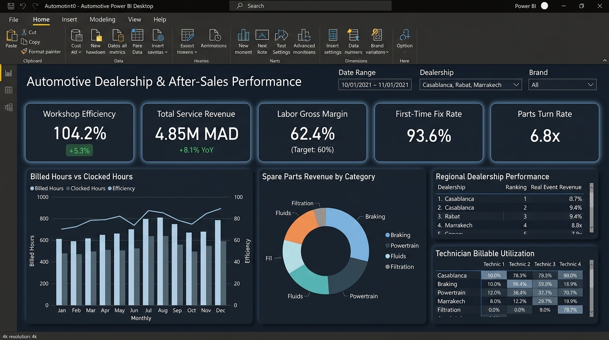
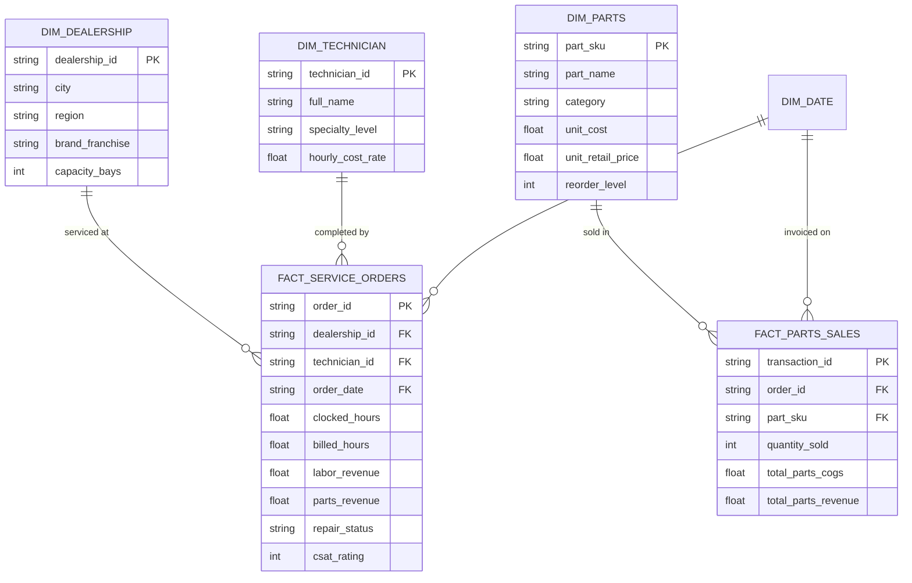

# 🚗 Automotive Dealership & After-Sales Performance Analytics Suite

[](https://powerbi.microsoft.com/)
[](https://learn.microsoft.com/en-us/dax/)
[](https://www.postgresql.org/)
[](https://www.python.org/)

An enterprise-grade **Business Intelligence & KPI Analytics solution** engineered to optimize multi-brand automotive dealership networks, after-sales service operations, workshop productivity, and spare parts inventory turnover.

---

## 📊 Executive Dashboard Preview



*Dark-mode executive view designed in Power BI Desktop featuring dynamic date range, dealership branch, and vehicle franchise filtering.*

| Section | Core Business Visuals | Primary Evaluated DAX Measures |
| :--- | :--- | :--- |
| **KPI Scorecard** | 5 Executive KPI Cards with dynamic status badges | `[Total Revenue MAD]`, `[Workshop Efficiency %]`, `[Labor Gross Margin %]`, `[First-Time Fix Rate %]`, `[Parts Turnover Ratio]` |
| **Operational Efficiency** | Monthly Billed vs. Clocked Hours dual-axis combo chart | `[Total Billed Hours]`, `[Total Clocked Hours]`, `[Workshop Efficiency %]` |
| **Consumables & Parts** | Spare Parts Revenue distribution donut chart | `[Parts Revenue MAD]`, `[Parts Margin %]` |
| **Regional Benchmark** | Dealership rankings (Casablanca, Rabat, Marrakech) | `[Revenue Rank by Dealership]`, `[Dealership Revenue Contribution %]` |
| **Workforce Allocation** | Technician billable utilization matrix by specialty | `[Tech Billable Utilization %]` |

---

## 🎯 Executive Overview & Business Problem

Automotive dealership groups face complex operational challenges in after-sales management:
- **Workshop Utilization & Technician Idle Time**: Low visibility into technician billable efficiency vs. clocked clock-in hours.
- **Spare Parts Inventory Carrying Cost**: Overstocking slow-moving parts while encountering stockouts on critical service items.
- **Revenue Leakage & Margin Erosion**: Lack of real-time variance tracking between actual labor/parts margins and corporate budget targets.
- **Customer Turnaround Time**: Delays in repair order (RO) cycle time impacting customer satisfaction (CSAT) and warranty retention.

This project delivers an end-to-end analytical architecture from raw transactional data ingestion to executive-ready Power BI reporting dashboards with automated variance analysis and drill-through capabilities.

---

## 🏗️ Dimensional Data Architecture (Star Schema)

The data model adheres to strict Kimball dimensional modeling principles, optimized for high-performance VertiPaq engine compression and instantaneous DAX evaluation:



---

## 📊 Core KPI Definitions & Production DAX Measures

The solution includes over **35 production-grade DAX measures** covering four functional pillars:

### 1. Workshop Efficiency & Productivity
$$\text{Workshop Efficiency \%} = \frac{\sum \text{Billed Labor Hours}}{\sum \text{Clocked Labor Hours}}$$

$$\text{Technician Utilization \%} = \frac{\sum \text{Clocked Working Hours}}{\sum \text{Available Shift Hours}}$$

### 2. Spare Parts Inventory & Commercial Health
$$\text{Inventory Turn Rate} = \frac{\text{Cost of Goods Sold (COGS)}}{\text{Average Inventory Value}}$$

$$\text{Parts Gross Margin \%} = \frac{\text{Parts Revenue} - \text{Parts COGS}}{\text{Parts Revenue}}$$

### 3. Financial Performance & Time Intelligence
- **YoY Revenue Variance**: `[Revenue Current Year] - [Revenue Previous Year]`
- **Variance % vs Budget**: `DIVIDE([Actual Revenue] - [Budget Revenue], [Budget Revenue])`
- **Rolling 3-Month Trailing Average**: Evaluated dynamically over the date dimension.

*(See full implementations in [`dax_measures.dax`](./dax_measures.dax))*

---

## 🚀 Key Technical Features

1. **Optimized Star Schema**: Clean 1-to-Many relationships with unidirectional cross-filtering for maximum query speed and sub-second visual refresh times.
2. **Dynamic Time Intelligence**: Calendar table generated in DAX supporting fiscal year, ISO weeks, Year-over-Year, and Month-to-Date metrics.
3. **Row-Level Security (RLS)**: Secure role definitions allowing regional managers to view all branch KPIs while dealership directors access only their location data.
4. **Interactive Navigation & UX**: Tooltip report pages, dynamic parameter switching between Currency (MAD / EUR / USD), bookmark-driven scenario toggles, and drill-through pages for root-cause repair order inspection.
5. **Data Quality Gates**: Automated Power Query M validation flagging unmatched technician IDs, negative inventory quantities, and out-of-period transactions.

---

## 📁 Repository Structure

```text
├── README.md                  # Comprehensive project documentation
├── dax_measures.dax           # 35+ Production-grade DAX measures
├── star_schema.sql            # DDL script for relational data warehouse tables
├── generate_mock_data.py      # Python script generating realistic transactional datasets
├── data/                      # Generated CSV mock datasets for Power BI import
│   ├── dim_dealership.csv
│   ├── dim_technician.csv
│   ├── dim_parts.csv
│   └── fact_service_orders.csv
└── dashboard_wireframe.md     # Visual layout wireframe and UX specifications
```

---

## ⚡ Quick Start & Reproduction

1. **Clone the repository**:
   ```bash
   git clone https://github.com/adileldirissi/automotive-aftersales-powerbi.git
   cd automotive-aftersales-powerbi
   ```

2. **Generate mock data**:
   ```bash
   python3 generate_mock_data.py
   ```

3. **Load into Power BI**:
   - Open Power BI Desktop.
   - Select **Get Data** $\rightarrow$ **Folder** or **CSV** pointing to the `data/` directory.
   - Run the relationships script or verify auto-detected foreign keys matching `star_schema.sql`.
   - Copy the measures from `dax_measures.dax` into your measures table.

---

## 👤 Author
**Adil El Idrissi**  
Big Data & AI Engineer | Lead Data Analyst & Power BI Consultant  
LinkedIn: [linkedin.com/in/adilelidrissi](https://linkedin.com/in/adilelidrissi) | GitHub: [github.com/adileldirissi](https://github.com/adileldirissi)
